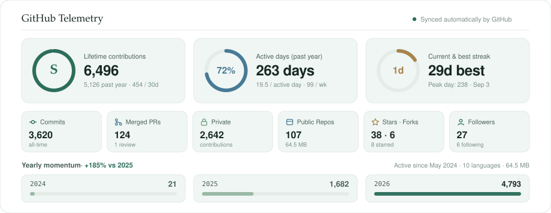

<picture>
  <source media="(prefers-color-scheme: dark)" srcset="./assets/hero-dark.svg" />
  <source media="(prefers-color-scheme: light)" srcset="./assets/hero-light.svg" />
  
</picture>

 

🌐 [Portfolio](https://elvin-juma-portfolio.vercel.app) &nbsp;·&nbsp;
🏢 [GTSS](https://gtss.software) &nbsp;·&nbsp;
💼 [LinkedIn](https://www.linkedin.com/in/elvin-juma-680747281) &nbsp;·&nbsp;
𝕏 [@Elvinoace](https://x.com/Elvinoace) &nbsp;·&nbsp;
✉️ [Email](mailto:omondielvin@gmail.com)

 

  

<picture>
  <source media="(prefers-color-scheme: dark)" srcset="./assets/stats-overview-dark.svg" />
  <source media="(prefers-color-scheme: light)" srcset="./assets/stats-overview-light.svg" />
  
</picture>

  

<picture>
  <source media="(prefers-color-scheme: dark)" srcset="./assets/stats-rhythm-dark.svg" />
  <source media="(prefers-color-scheme: light)" srcset="./assets/stats-rhythm-light.svg" />
  
</picture>

 

### ✨ Selected Work

| Project | Focus | Links |
| :--- | :--- | :--- |
| 🩺 **Afyvia** | Multi-tenant pharmacy &amp; clinical OS | [Live](https://afyvia.gtss.software) · [Repo](https://github.com/Elvinoacer/pharmacy_template_tier2)<!-- STAR:pharmacy_template_tier2 --> · ★ 18<!-- /STAR:pharmacy_template_tier2 --> |
| ⚡ **JustInTime** | Hyperlocal services marketplace &amp; M-Pesa | [Live](https://justintime.gtss.software) |
| 🍽️ **Hotel Intranet** | Offline-first LAN hospitality POS &amp; KDS | [Repo](https://github.com/Elvinoacer/hotel-intranet)<!-- STAR:hotel-intranet --> · ★ 17<!-- /STAR:hotel-intranet --> |
| 🧭 **Kampus** | Campus community &amp; peer marketplace | [Live](https://moimashinani.gtss.software) · [Repo](https://github.com/Elvinoacer/Kampus)<!-- STAR:Kampus --> · ★ 1<!-- /STAR:Kampus --> |
| 🏛️ **Concept Builders** | Architectural plans &amp; client platform | [Live](https://www.conceptbuilders.co.ke) |
| 🎓 **German Virtual School** | Live CEFR A1–C2 language academy | [Live](https://www.germanvirtualschool.com) |

 

<picture>
  <source media="(prefers-color-scheme: dark)" srcset="./assets/activity-flow-dark.svg" />
  <source media="(prefers-color-scheme: light)" srcset="./assets/activity-flow-light.svg" />
  
</picture>

 

<!-- LAST_UPDATED:START -->
Auto-synced by GitHub Actions · Nov 26, 2026
<!-- LAST_UPDATED:END -->

