 

  
  
  
  

 

  
  

  
    <b>01 AFYVIA:</b> <a href="https://afyvia.gtss.software">Live</a> · <a href="https://github.com/Elvinoacer/pharmacy_template_tier2">Repo</a> · <a href="https://github.com/Elvinoacer/sphere_pharmacy">Sphere</a>
    &nbsp;&nbsp;&nbsp;✦&nbsp;&nbsp;&nbsp;
    <b>02 JUSTINTIME:</b> <a href="https://justintime.gtss.software">Live</a> · <a href="https://github.com/Elvinoacer/JustinTime">Repo</a> · <a href="https://github.com/Elvinoacer/jit-socket">Socket</a>
  

  
  

  
    <b>03 LAN POS:</b> <a href="https://github.com/Elvinoacer/hotel-intranet">Intranet Repo</a> · <a href="https://github.com/Elvinoacer/hospitality">Hospitality</a>
    &nbsp;&nbsp;&nbsp;✦&nbsp;&nbsp;&nbsp;
    <b>04 KAMPUS:</b> <a href="https://moimashinani.gtss.software">Live</a> · <a href="https://github.com/Elvinoacer/Kampus">Kampus Repo</a> · <a href="https://github.com/Elvinoacer/moi_mashinani">Mashinani Repo</a>
  

  
  

  
    <b>05 CONCEPT BUILDERS:</b> <a href="https://www.conceptbuilders.co.ke">Live</a> · <a href="https://github.com/Elvinoacer/concept-builders">Repo</a> · <a href="https://github.com/Elvinoacer/concept-builders-sockets">Socket</a>
    &nbsp;&nbsp;&nbsp;✦&nbsp;&nbsp;&nbsp;
    <b>06 GERMAN VIRTUAL SCHOOL:</b> <a href="https://www.germanvirtualschool.com">Live</a> · <a href="https://github.com/Elvinoacer/German-Virtual-School">Repo</a> · <a href="https://github.com/Elvinoacer/gvs-socket-server">Socket</a>
  

<b>✦ MORE ORBITING SYSTEMS (12 PUBLIC REPOS &amp; LIVE DEPLOYMENTS)</b>

 

| System | Metric | Links |
| :--- | :--- | :--- |
| **GTSS Control Plane** | Multi-Product SaaS Nexus | [gtss.software](https://gtss.software) · [Repo](https://github.com/Elvinoacer/gtss) |
| **Neural Precision 3D** | `31MB` WebGL Showcase | [Live](https://neural-precision-portfolio.vercel.app) · [Repo](https://github.com/Elvinoacer/neural-precision-portfolio) |
| **Elvin 3D Portfolio** | `18MB` Interactive Portfolio | [Live](https://elvin-juma-portfolio.vercel.app) · [Repo](https://github.com/Elvinoacer/elvinJuma-portfolio) |
| **Church Management OS** | `36MB` Tithe & Member ERP | [Live](https://church-web-v2.vercel.app) · [Repo](https://github.com/Elvinoacer/church-web-v2) |
| **Zion Hill Digital** | `41MB` Ministry Platform | [Live](https://zion-hill.vercel.app) · [Repo](https://github.com/Elvinoacer/ZION-HILL) |
| **20Timeline** | `40MB` Temporal Engine | [Live](https://20timeline.vercel.app) · [Repo](https://github.com/Elvinoacer/20timeline) |
| **ELC IEC Electoral OS** | Real-Time Ballot Tallying | [Live](https://elciec.gtss.software) · [Repo](https://github.com/Elvinoacer/ELC_IEC_mu) |
| **Commersely** | Multi-Vendor Storefront | [Live](https://commerseley.vercel.app) · [Repo](https://github.com/Elvinoacer/commerseley) |
| **GTSS Growth Engine** | CRM & Outreach Automation | [Repo](https://github.com/Elvinoacer/gtss_growth_automation) · [WA Engine](https://github.com/Elvinoacer/whatsapp_campaigns) |
| **Kenya Airways 254** | Live Flight Socket Telemetry | [Live](https://kenya-airways-254.vercel.app) · [Repo](https://github.com/Elvinoacer/kenya_airways_254) |
| **International KYC Hub** | `9.3MB` Compliance Portal | [Live](https://internationalkychub.vercel.app) · [Repo](https://github.com/Elvinoacer/internationalkychub) |
| **MultiPay Gateway** | PayPal + M-Pesa STK Push | [Live](https://multipay-demo.vercel.app) · [Repo](https://github.com/Elvinoacer/multipay-demo) |

 

  

