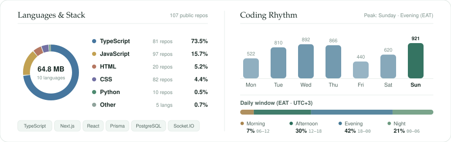

<picture>
  <source media="(prefers-color-scheme: dark)" srcset="./assets/hero-dark.svg" />
  <source media="(prefers-color-scheme: light)" srcset="./assets/hero-light.svg" />
  
</picture>

 

[Portfolio](https://elvin-juma-portfolio.vercel.app) &nbsp;·&nbsp;
[GTSS](https://gtss.software) &nbsp;·&nbsp;
[LinkedIn](https://www.linkedin.com/in/elvin-juma-680747281) &nbsp;·&nbsp;
[X / Twitter](https://x.com/Elvinoace) &nbsp;·&nbsp;
[Email](mailto:omondielvin@gmail.com)

 

I'm **Elvin Omondi Juma**, a full-stack product engineer, founding engineer at **[Great Thumbs Software Solutions (GTSS)](https://gtss.software)**, and Computer Science student at **Moi University** in Eldoret, Kenya.

I design and build durable, end-to-end software for everyday operations — spanning multi-tenant healthcare platforms, hyperlocal service marketplaces, offline-first local-network POS systems, and education tools. My goal is quiet reliability: understand how people actually work, strip away unnecessary complexity, and ship software they can depend on.

 

## Live GitHub Telemetry

<picture>
  <source media="(prefers-color-scheme: dark)" srcset="./assets/stats-overview-dark.svg" />
  <source media="(prefers-color-scheme: light)" srcset="./assets/stats-overview-light.svg" />
  
</picture>

  

<picture>
  <source media="(prefers-color-scheme: dark)" srcset="./assets/stats-rhythm-dark.svg" />
  <source media="(prefers-color-scheme: light)" srcset="./assets/stats-rhythm-light.svg" />
  
</picture>

 

## Selected Work

<table>
<tr>
<td width="50%" valign="top">

**Afyvia · PharmaCare OS**  
Multi-tenant pharmacy, clinic, and patient care operating system with 4 portals, FEFO batch inventory, AI symptom triage, and M-Pesa STK checkout.  
`Next.js` `TypeScript` `Prisma` `PostgreSQL` `M-Pesa`  
[Live platform](https://afyvia.gtss.software) · [Source](https://github.com/Elvinoacer/pharmacy_template_tier2)<!-- STAR:pharmacy_template_tier2 --> · ★ 17<!-- /STAR:pharmacy_template_tier2 -->

</td>
<td width="50%" valign="top">

**JustInTime**  
Hyperlocal services marketplace for Kenya connecting customers and providers through geolocation discovery, proposals, real-time chat, and M-Pesa Daraja escrow.  
`Next.js` `TypeScript` `Socket.IO` `Prisma` `M-Pesa`  
[Live platform](https://justintime.gtss.software)

</td>
</tr>
<tr>
<td width="50%" valign="top">

**Restaurant Manager · LAN POS**  
Offline-first hospitality POS and Kitchen Display System running over local WiFi without cloud dependency — guest QR ordering, waiter handhelds, and admin controls.  
`Electron` `Node.js` `Socket.IO` `IndexedDB` `LAN`  
[Source](https://github.com/Elvinoacer/hotel-intranet)<!-- STAR:hotel-intranet --> · ★ 17<!-- /STAR:hotel-intranet -->

</td>
<td width="50%" valign="top">

**Kampus & Moi Mashinani**  
University community directory, student discovery, and peer-to-peer campus marketplace built for mobile and web.  
`React Native` `Expo` `Next.js` `TypeScript` `PostgreSQL`  
[Moi Mashinani](https://moimashinani.gtss.software) · [Kampus Source](https://github.com/Elvinoacer/Kampus)<!-- STAR:Kampus --> · ★ 1<!-- /STAR:Kampus -->

</td>
</tr>
<tr>
<td width="50%" valign="top">

**Concept Builders**  
Architectural house-plan catalog and client consultation platform tailored for East Africa, with structured project discovery and multi-gateway checkout.  
`Next.js` `TypeScript` `PostgreSQL` `M-Pesa`  
[Live platform](https://www.conceptbuilders.co.ke)

</td>
<td width="50%" valign="top">

**German Virtual School**  
Virtual language academy (CEFR A1–C2) bringing live video classes, attendance tracking, student portals, and school administration together.  
`Next.js` `TypeScript` `WebSockets` `Prisma`  
[Live platform](https://www.germanvirtualschool.com)

</td>
</tr>
</table>

Working toolkit &amp; engineering stack

 

| Area | Tools |
| :--- | :--- |
| **Web & Mobile** | TypeScript, Next.js, React, Tailwind CSS, React Native, Expo |
| **Backend & Data** | Node.js, PostgreSQL, Prisma, Redis, REST &amp; GraphQL APIs |
| **Real-Time & Offline** | Socket.IO, WebSockets, Electron, IndexedDB, local-network systems |
| **Payments & Integrations** | M-Pesa Daraja, IntaSend, Firebase / FCM, webhooks, AI workflows |
| **Infrastructure** | Linux, Git, GitHub Actions, Docker, Vercel, Neon |

 

## The Quiet Horizon

<picture>
  <source media="(prefers-color-scheme: dark)" srcset="./assets/activity-horizon-dark.svg" />
  <source media="(prefers-color-scheme: light)" srcset="./assets/activity-horizon-light.svg" />
  
</picture>

 

### Recently Tended

<!-- RECENT_ACTIVITY:START -->
| Repository | Focus & Latest Update | Language | Tended |
| :--- | :--- | :--- | ---: |
| [**sphere_pharmacy**](https://github.com/Elvinoacer/sphere_pharmacy) · [Live](https://sphere-pharmacy.vercel.app) | Digital storefront, OTC medicine catalog, prescription uploads & clinical service booking… Latest commit: refills | `TypeScript` | just now |
| [**api_data_transformer**](https://github.com/Elvinoacer/api_data_transformer) | High-throughput TypeScript API schema transformation, normalization & validation pipeline. Latest commit: keep single update:codebase npm script | `TypeScript` | 14h ago |
| [**tovolana_writers**](https://github.com/Elvinoacer/tovolana_writers) · [Live](https://tovolana-writers.vercel.app) | just write whatever you feel Latest commit: Add changes without temporary screen design images | `TypeScript` | 16h ago |
| [**moi_mashinani**](https://github.com/Elvinoacer/moi_mashinani) · [Live](https://moimashinani.gtss.software) | Hyperlocal university community directory, student profiles & campus business discovery… Latest commit: added best profile here | `TypeScript` | 3d ago |
| [**afyaqueue**](https://github.com/Elvinoacer/afyaqueue) | Real-Time Healthcare Appointment & Queue Management Platform for Moi Teaching & Referral… Latest commit: silence benign gcp metadata probe warning on local emulators | `TypeScript` | 7d ago |
<!-- RECENT_ACTIVITY:END -->

 

If you're building a thoughtful product or solving a stubborn operational problem, feel free to reach out at **[omondielvin@gmail.com](mailto:omondielvin@gmail.com)**.

<!-- LAST_UPDATED:START -->
Updated automatically via GitHub Actions on November 20, 2026 · 6,481 lifetime contributions across 107 public repositories
<!-- LAST_UPDATED:END -->

