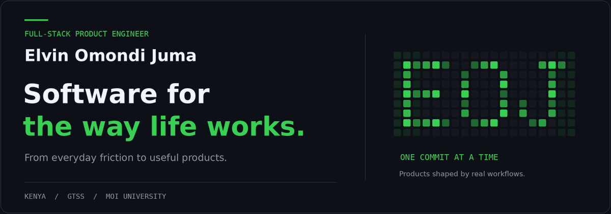

<picture>
  <source media="(prefers-reduced-motion: reduce) and (max-width: 600px)" srcset="./assets/profile-hero-mobile.png" />
  <source media="(prefers-reduced-motion: reduce)" srcset="./assets/profile-hero.png" />
  <source media="(max-width: 600px)" srcset="./assets/profile-hero-mobile.gif" />
  
</picture>

  <a href="#the-story">The story</a> &nbsp; / &nbsp;
  <a href="#selected-work">Selected work</a> &nbsp; / &nbsp;
  <a href="#how-i-build">How I build</a> &nbsp; / &nbsp;
  <a href="#lets-talk">Let's talk</a>

## The story

A customer looking for medicine. A restaurant taking orders over an unreliable connection. A service provider trying to turn an inquiry into paid work. These are the kinds of problems that draw me to software.

I'm **Elvin Omondi Juma**, a **full-stack product engineer**, founding engineer at **GTSS**, and Computer Science student at **Moi University**, Kenya. I build across the whole product: the experience people see, the systems behind it, and the operations that keep it useful.

My work spans healthcare, local commerce, hospitality, and education. The common thread is practical: understand how people already work, find the friction, and build something they can depend on.

> Good software should make the next step clearer for the person using it.

## Selected work

### 01 / Afyvia

**Helping neighborhood pharmacies become easier to find and connect with.**

I'm building a pharmacy network where customers can discover nearby pharmacies, check listed medicine availability, explore services, and send prescription requests for pharmacist review. Pharmacies get a digital storefront and tools to manage customer relationships.

The engineering work centers on **tenant isolation, pharmacy onboarding, prescription review, subscriptions, and the customer journey**.

`Next.js` `TypeScript` `Prisma` `PostgreSQL`

[Explore Afyvia](https://afyvia.gtss.software/)

---

### 02 / JustInTime

**Connecting a local need to someone who can do the work.**

A services marketplace for Kenya, bringing discovery, proposals, bookings, conversations, and M-Pesa payment flows into one product for customers and service providers.

The engineering work centers on **multiple user roles, location-based discovery, booking state, real-time communication, and payment reconciliation**.

`Next.js` `TypeScript` `Prisma` `Socket.IO` `M-Pesa`

[Explore JustInTime](https://justintime.gtss.software/)

---

### 03 / Restaurant Manager

**Keeping service moving when the internet doesn't.**

An offline-first restaurant system designed around the local network, connecting guest orders, waiters, the kitchen, and administration without making every interaction depend on an internet connection.

The engineering work centers on **local state, kitchen events, order ownership, staff permissions, and payment verification**.

`Electron` `Node.js` `Socket.IO` `Local network`

<b>More work across commerce, community, and education</b>

 

| Project | What it brings together | Explore |
| --- | --- | --- |
| **Concept Builders** | Architectural house plans, design discovery, and client inquiries for the Kenyan market. | [Website](https://www.conceptbuilders.co.ke/) |
| **Kampus** | A mobile student platform for campus community, discovery, and a marketplace. Built with React Native and Expo. | [Public repository](https://github.com/Elvinoacer/Kampus) |
| **German Virtual School** | Live language classes, student and teacher workflows, and school administration. | [Website](https://www.germanvirtualschool.com/) |

## How I build

<picture>
  <source media="(prefers-reduced-motion: reduce) and (max-width: 600px)" srcset="./assets/build-loop-mobile.png" />
  <source media="(prefers-reduced-motion: reduce)" srcset="./assets/build-loop.png" />
  <source media="(max-width: 600px)" srcset="./assets/build-loop-mobile.gif" />
  
</picture>

**Start with the workflow.** Talk to the people doing the work. Map their decisions and handoffs before deciding what the product needs.

**Build the useful core.** Connect the interface to real permissions, data, and operations. Keep the design clear enough to change as the business learns.

**Treat failure as part of the product.** A delayed callback, a dropped connection, or a repeated click should have an intentional outcome. I pay attention to state transitions, retries, and recovery.

**Improve from feedback.** Put the product in front of the people it serves, watch where they get stuck, and make the next iteration more useful.

**Use AI with judgment.** I use agents to accelerate research, implementation, and review. I stay responsible for the architecture, validation, and the final result.

### Tools, chosen for the job

| Where | My working toolkit |
| --- | --- |
| **Web & mobile** | TypeScript · Next.js · React · Tailwind CSS · React Native · Expo |
| **Backend & data** | Node.js · PostgreSQL · Prisma · REST APIs · webhooks |
| **Real-time & desktop** | Socket.IO · Electron · local and offline-first systems |
| **Integrations** | M-Pesa / Daraja · notifications · maps · customer communication |
| **Delivery** | Git · GitHub · Linux · Vercel · Cloudflare · AI-assisted engineering |

## Where I'm going

My current product focus is **Afyvia**: making pharmacy discovery and customer communication more useful, while working toward practical stock synchronization with existing pharmacy systems.

Alongside shipping, I'm deepening my grounding in **computer science and business**, with a growing interest in **healthcare and biology**. I want to understand both how a system works and why it matters to the people relying on it.

## Let's talk

If you're building a product, running a business with a difficult workflow, or exploring a technical partnership, I'd like to hear what you're working on.

**[omondielvin@gmail.com](mailto:omondielvin@gmail.com)**

