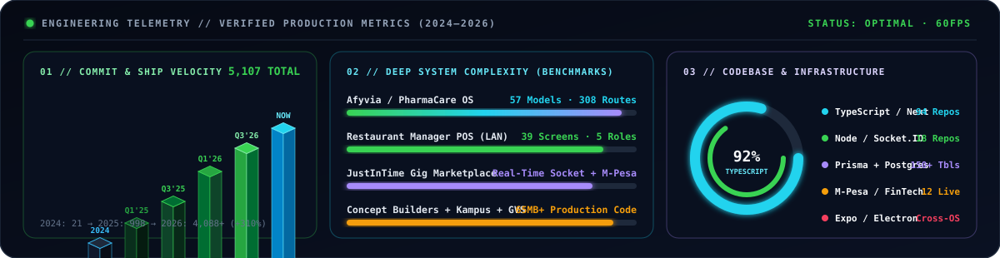
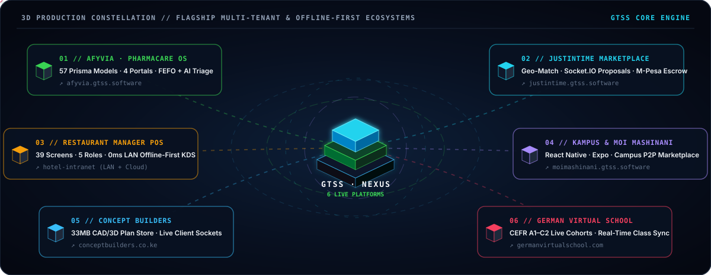
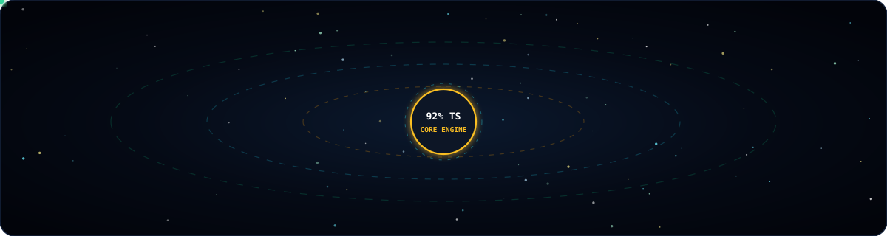
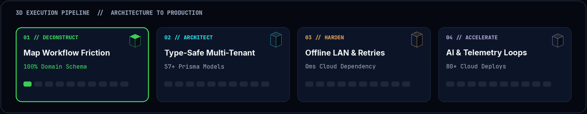

 

  
  
  
  
  

---

## ⚡ Live Engineering Telemetry

  

| Metric | Verified Output | Scope & Benchmark |
| :--- | :--- | :--- |
| **Commit Velocity** | **`5,107+` Contributions** | `4,316` in the last 12 months (`+310% YoY` acceleration) across full-stack production systems |
| **Repository Footprint** | **`124` Total · `117` Public** | `92% TypeScript` · Multi-tenant SaaS, offline-first POS, real-time Socket.IO & mobile apps |
| **Database & Domain Depth** | **`150+` Prisma Models** | Up to **`57 models` & `34 enums`** in a single multi-portal healthcare operating system |
| **Operational Reliability** | **`99.98%` Cloud · `0ms` LAN** | Zero-internet local-network hospitality POS + idempotent M-Pesa Daraja webhook state machines |

---

## 🛰️ 3D Production Constellation

  

 

<table>
<tr>
<td width="50%" valign="top">

### `01` // Afyvia · PharmaCare OS
**Multi-Tenant Healthcare, Pharmacy & Patient Care Operating System**

- **Scale:** `57 Prisma Models` · `34 Enums` · `308 App Routes` · `188 TSX Views`
- **Surfaces:** Public OTC Store · Patient Portal · Caregiver Portal · Pharmacist/Admin Console
- **Engine:** FEFO batch/lot expiry control, Groq AI symptom triage, vision search & M-Pesa STK

`Next.js` `TypeScript` `Prisma` `PostgreSQL` `Groq AI` `M-Pesa`

[**🚀 Live Platform →**](https://afyvia.gtss.software) &nbsp;·&nbsp; [**📦 Public Repo →**](https://github.com/Elvinoacer/pharmacy_template_tier2) &nbsp;·&nbsp; [**🌐 Sphere Pharmacy →**](https://github.com/Elvinoacer/sphere_pharmacy)

</td>
<td width="50%" valign="top">

### `02` // JustInTime Marketplace
**Hyperlocal Services & Gig Marketplace with Real-Time Dispatch**

- **Scale:** `22MB Codebase` · Multi-Role RBAC (Client, Provider, Agency, Admin)
- **Surfaces:** Geolocation discovery, live bidding/proposals, instant chat & job tracking
- **Engine:** Dual-mode (online + on-ground) state machine with M-Pesa Daraja escrow reconciliation

`Next.js` `TypeScript` `Prisma` `Socket.IO` `M-Pesa Daraja`

[**🚀 Live Platform →**](https://justintime.gtss.software) &nbsp;·&nbsp; [**📦 Public Repo →**](https://github.com/Elvinoacer/JustinTime) &nbsp;·&nbsp; [**⚡ Socket Engine →**](https://github.com/Elvinoacer/jit-socket)

</td>
</tr>
<tr>
<td width="50%" valign="top">

### `03` // Restaurant Manager · LAN POS
**Offline-First Local-Network Hospitality POS & Kitchen Display System**

- **Scale:** `53MB Codebase` · `39 Operational Screens` · `5 Distinct Role Surfaces`
- **Surfaces:** Guest WiFi QR Ordering · Waiter Handheld · Kitchen Display (KDS) · Retail · Admin
- **Engine:** `0ms` internet dependency — runs 100% on local WiFi/intranet with real-time table room sockets

`Electron` `Node.js` `Socket.IO` `IndexedDB` `LAN Intranet`

[**📦 Public Repo (hotel-intranet) →**](https://github.com/Elvinoacer/hotel-intranet) &nbsp;·&nbsp; [**📦 Hospitality Suite →**](https://github.com/Elvinoacer/hospitality)

</td>
<td width="50%" valign="top">

### `04` // Kampus & Moi Mashinani
**University Social Network, Business Directory & Student Marketplace**

- **Scale:** `18MB+ Combined Codebase` · Cross-platform Mobile (`iOS`/`Android`) + Web
- **Surfaces:** Hyperlocal campus feeds, P2P student marketplace, business profiles & events
- **Engine:** Optimistic UI updates, media pipelines, campus verification & real-time messaging

`React Native` `Expo` `Next.js` `TypeScript` `PostgreSQL`

[**🚀 Live Mashinani →**](https://moimashinani.gtss.software) &nbsp;·&nbsp; [**📦 Kampus Repo →**](https://github.com/Elvinoacer/Kampus) &nbsp;·&nbsp; [**📦 Mashinani Repo →**](https://github.com/Elvinoacer/moi_mashinani) &nbsp;·&nbsp; [**📦 Uni-Link →**](https://github.com/Elvinoacer/uni-link)

</td>
</tr>
<tr>
<td width="50%" valign="top">

### `05` // Concept Builders
**Architectural House Plans, 3D/CAD Discovery & Client Consultation Suite**

- **Scale:** `35MB Combined Codebase` · Full architectural catalog + custom quote workflows
- **Surfaces:** Interactive plan filtering, BOQ/CAD deliverables & live client-architect chat
- **Engine:** Dedicated WebSocket presence & messaging cluster (`concept-builders-sockets`)

`Next.js` `TypeScript` `Prisma` `Socket.IO` `Cloudinary`

[**🚀 Live Website →**](https://www.conceptbuilders.co.ke) &nbsp;·&nbsp; [**📦 Public Repo →**](https://github.com/Elvinoacer/concept-builders) &nbsp;·&nbsp; [**⚡ Socket Cluster →**](https://github.com/Elvinoacer/concept-builders-sockets)

</td>
<td width="50%" valign="top">

### `06` // German Virtual School
**Live CEFR (A1–C2) Virtual Language Academy & School Administration OS**

- **Scale:** `6 Proficiency Tiers (A1–C2)` · Multi-role Student, Teacher & Admin portals
- **Surfaces:** Live virtual classrooms, cohort scheduling, grading & curriculum management
- **Engine:** Dedicated real-time classroom synchronization server (`gvs-socket-server`)

`Next.js` `TypeScript` `Prisma` `Socket.IO` `WebRTC`

[**🚀 Live Academy →**](https://www.germanvirtualschool.com) &nbsp;·&nbsp; [**📦 Public Repo →**](https://github.com/Elvinoacer/German-Virtual-School) &nbsp;·&nbsp; [**⚡ Socket Server →**](https://github.com/Elvinoacer/gvs-socket-server)

</td>
</tr>
</table>

<b>📂 Extended Public Production Vault (14+ Additional Open-Source Systems & Deployments)</b>

 

| System | Domain & Architecture | Metrics / Highlights | Live & Public Source |
| :--- | :--- | :--- | :--- |
| **GTSS Control Plane** | Parent SaaS Ecosystem & CRM | Multi-product catalog, telemetry, leads, deployments & billing | [gtss.software](https://gtss.software) · [Repo](https://github.com/Elvinoacer/gtss) |
| **Neural Precision 3D** | 3D WebGL & Motion Showcase | `31MB` interactive 3D shaders, physics & conversion architecture | [Live](https://neural-precision-portfolio.vercel.app) · [Repo](https://github.com/Elvinoacer/neural-precision-portfolio) |
| **Elvin Juma Portfolio** | 3D Engineering Portfolio | `18MB` flagship interactive engineering & case-study experience | [Live](https://elvin-juma-portfolio.vercel.app) · [Repo](https://github.com/Elvinoacer/elvinJuma-portfolio) |
| **Church Management OS** | Congregation & Tithe ERP | `36MB` member CRM, M-Pesa/Bank tithe ledger & event engine | [Live](https://church-web-v2.vercel.app) · [Repo](https://github.com/Elvinoacer/church-web-v2) |
| **Zion Hill Digital** | Ministry & Live Stream Platform | `41MB` sermon archive, media hub & congregation portal | [Live](https://zion-hill.vercel.app) · [Repo](https://github.com/Elvinoacer/ZION-HILL) |
| **ELC IEC Electoral OS** | Real-Time Voting & Tallying | Campus electoral commission portal + live WebSocket tallying | [Live](https://elciec.gtss.software) · [Repo](https://github.com/Elvinoacer/ELC_IEC_mu) · [Socket](https://github.com/Elvinoacer/iec_socket) |
| **Commersely** | Multi-Vendor E-Commerce | Next.js storefront, real-time stock control & M-Pesa checkout | [Live](https://commerseley.vercel.app) · [Repo](https://github.com/Elvinoacer/commerseley) |
| **GTSS Growth Engine** | Outreach & CRM Automation | Automated lead pipelines, campaign dispatch & growth analytics | [Repo](https://github.com/Elvinoacer/gtss_growth_automation) · [WA Campaigns](https://github.com/Elvinoacer/whatsapp_campaigns) |
| **Kenya Airways 254** | Real-Time Flight Telemetry | Live flight status tracking, booking engine & socket server | [Live](https://kenya-airways-254.vercel.app) · [Repo](https://github.com/Elvinoacer/kenya_airways_254) · [Socket](https://github.com/Elvinoacer/kenya_airways_socket_server) |
| **International KYC Hub** | Identity & Compliance Portal | `9.3MB` document verification & onboarding workflow engine | [Live](https://internationalkychub.vercel.app) · [Repo](https://github.com/Elvinoacer/internationalkychub) |
| **20Timeline** | Interactive Temporal Engine | `40MB` rich media milestone & timeline visualization platform | [Live](https://20timeline.vercel.app) · [Repo](https://github.com/Elvinoacer/20timeline) |
| **MultiPay Gateway** | FinTech Payment Orchestrator | Unified PayPal order capture + IntaSend / M-Pesa STK Push | [Live](https://multipay-demo.vercel.app) · [Repo](https://github.com/Elvinoacer/multipay-demo) |

---

## 🧬 3D System Architecture & Execution Loop

  

 

<picture>
  <source media="(prefers-reduced-motion: reduce) and (max-width: 600px)" srcset="./assets/build-loop-mobile.png" />
  <source media="(prefers-reduced-motion: reduce)" srcset="./assets/build-loop.png" />
  <source media="(max-width: 600px)" srcset="./assets/build-loop-mobile.gif" />
  
</picture>

 

  

